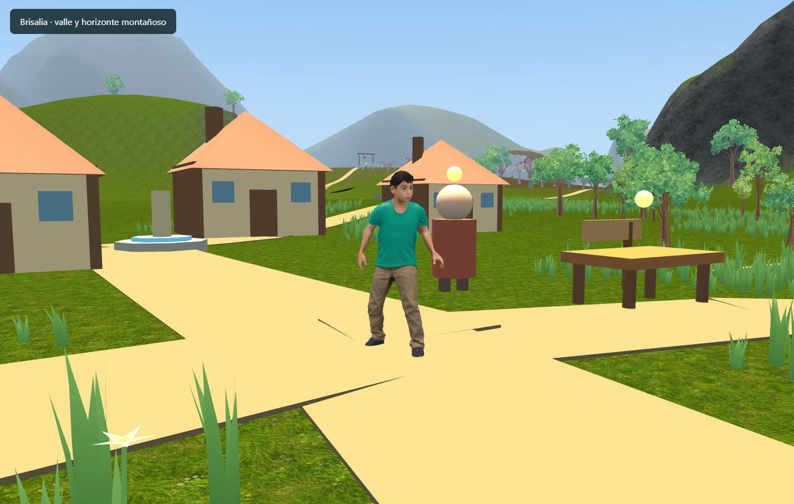
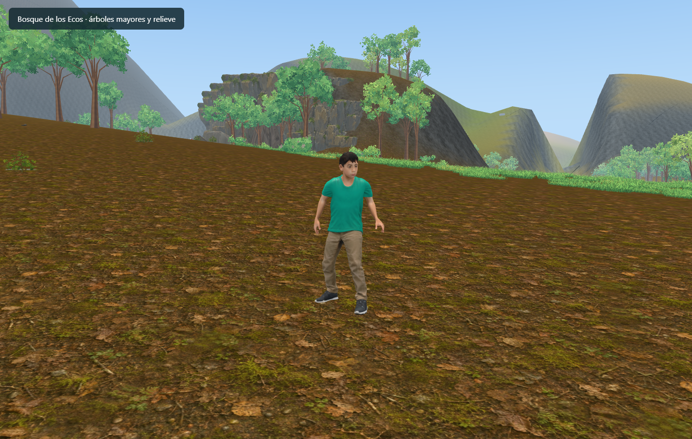
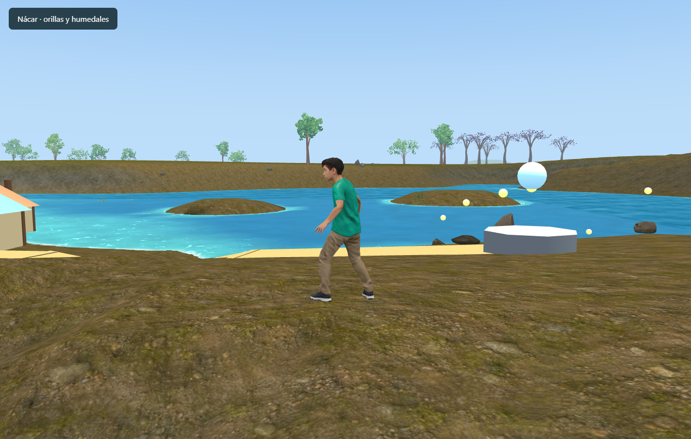

# Paisajes y superficies de Auralia

Implementación del 8 de noviembre de 2026. Amplía el piloto de Brisalia descrito en [PILOTO_VALLE_FAROLES.md](PILOTO_VALLE_FAROLES.md). El tamaño definitivo del mundo continúa abierto; este cambio trabaja sobre las coordenadas actuales.

## Estado: prototipo de paisaje, no acabado visual

La existencia de relieve, materiales o regiones en el código no acredita que el mapa esté logrado. La revisión del usuario señala montañas demasiado básicas, texturas poco convincentes y problemas de apoyo. Esas observaciones siguen siendo criterios de aceptación pendientes: faltan composición artística, detalle geológico, transiciones de bioma y revisión de cada recorrido a escala del personaje.

## Base jugable existente

- Brisalia queda encajada entre lomas, una meseta elevada y montañas visibles desde el pueblo. La plataforma de la meseta pasa de 56 a 82 m; sus dos accesos tienen nuevos perfiles transitables.
- Nueve formas de relieve grandes definen sierras occidentales, agujas del Amanecer, un macizo alpino, el Crisol con depresión de caldera, mesas del Ocaso, escarpes malditos, una pared selvática y colinas al sur. Las elevaciones nominales añadidas van de 62 a 420 m; las reservas de caminos, agua y lugares existentes atenúan esas alturas.
- El terreno cambia gradualmente entre pradera, suelo fértil, hojarasca, barro, estepa, grava, arena, arcilla roja, basalto, suelo maldito y selva. Las laderas tienen proyección de roca en tres ejes y las cumbres alpinas acumulan nieve por altura.
- Los árboles decorativos verdes del sistema principal son un 62,5 % más grandes; los secos, un 50 %. Los árboles procedurales de la expansión aumentan un 40 %. Las ubicaciones manuales, el bosque ilustrado específico y los árboles de recursos mantienen su diseño anterior.
- Se reducen los candidatos de árboles de 25 a 14 por sector. La distribución sigue siendo determinista, con instancias y modelos LOD compartidos; desierto, basalto y tierras malditas reciben menos vegetación. Se omite el pasto prehorneado en pendientes demasiado fuertes.

## Dónde verlo

Coordenadas del juego, con norte hacia Z negativo. Para apreciar la escala conviene salir del centro de Brisalia hacia la meseta y continuar al bosque.

| Lugar | X, Z aproximados | Cambio visible |
| --- | --- | --- |
| Brisalia | 1, 10 | Lomas y montañas cerrando el horizonte |
| Entrada al ascenso | -142, -92 | Camino principal a la meseta |
| Paso de los cerezos | -165, -170 | Segundo acceso a la meseta |
| Plataforma alta | -270, -95 | Vista sobre el valle |
| Bosque de los Ecos | -380, -320 | Árboles mayores, suelo forestal y escarpes |
| Nácar | 230, -240 | Orillas de barro y humedal |
| Mesas del Ocaso | -1330, -1690 | Arena y arcilla roja sobre mesetas |
| Crisol | -180, -1640 | Macizo volcánico y basalto |
| Tierras Malditas | 1040, -1860 | Superficie oscura y escarpes |
| Selva | 1360, -660 | Superficie húmeda y pared de cascadas |

Las regiones nuevas tienen una primera base de terreno y materiales. Sus poblados, fauna, templos, efectos volcánicos y decoración específica todavía requieren desarrollo; el atlas completo no está terminado. La primera red de galerías se describe abajo; no sustituye el resto de cuevas y mazmorras proyectadas.

## Texturas y presupuesto de memoria

Se incorporaron los 14 pares de albedo y normal del paquete `Auralia_Biomes_1K_Completo`, conservando los originales de 1024 × 1024 y su manifiesto bajo `public/assets/terrain/biomes/`. La carpeta de origen no se modifica.

En WebGL2 se cargan copias de trabajo de 512 × 512 en dos arrays compartidos: 14 capas nuevas más roca, nieve y lava anteriores. Son dos samplers para todo el terreno, sin copias por sector. El presupuesto RGBA8 estimado, incluyendo mipmaps, es **45,33 MiB de GPU**; los dos buffers de restauración de contexto suman **34 MiB de CPU**. A esto se añaden recursos transitorios de descarga y decodificación. Los bitmaps se cierran después de cada imagen y la decodificación es secuencial.

Es un presupuesto del material, no una medición de la memoria total de Chrome. Tampoco demuestra por sí mismo una mejora de FPS. Se mantienen la resolución geométrica y la distancia de streaming existentes.

Las normales del paquete están estimadas desde luminancia; se usan con intensidad moderada y se atenúan a distancia. No son mapas de altura ni modifican colisiones. WebGL1 mantiene el material anterior. Para comparar en WebGL2 puede usarse `?terrainMaterials=legacy`.

## Verificación

- TypeScript y compilación de producción comprobados. La compilación mantiene la advertencia conocida del bundle principal grande.
- Suites del proyecto ejecutadas: clima, cielo, resolución, Santi, dominio, construcción, atlas, geografía, streaming, pasto, vegetación, bosque, expansión, telemetría, shaders de follaje, accidentes geográficos, agua, props, geología y traversal. Nueva suite `test:biomes` para los 14 pares, presupuesto, transiciones, relieve y densidad.
- Las pruebas conservan las alturas históricas de construcciones, lugares protegidos, caminos y agua. Los dos puntos de terreno anteriormente vacíos que ahora reciben montañas se verifican como relieve elevado.
- Los ocho recorridos automatizados de subida/bajada, caminando/corriendo por ambos accesos, pasan. En Chrome, el controlador real completó las subidas principal y alternativa en 28,7 s y 12,0 s, sin atascarse.
- Se corrigió una interferencia detectada entre el nuevo relieve y la ribera superior: se reserva todo el corredor de hasta 90 m utilizado por el agua visible, además del cauce de juego.
- El shader WebGL2 compiló y cargó sus 17 capas sin errores. También se comprobó la compilación del material anterior mediante el parámetro de comparación.
- Comparación determinista sobre los mismos 391 sectores, terreno y máscaras: **320 → 201 árboles**, un **37,2 % menos**. La suma del área aproximada de copas crece **1,63 veces**. Esa suma es una métrica de tamaño, no una medida de cobertura de pantalla ni una garantía de FPS.

## Capturas de revisión

Capturas del motor real con Santi y hora diurna fija, usando una escena de revisión sin guardar cambios en la partida del usuario.

## Puntos de implementación

- `landscapeRelief.ts`: formas grandes y protección de la geografía existente; se integra en el muestreador canónico que comparten terreno y colisiones.
- `regionalReliefData.ts`: versión 2 del piloto y perfiles de los dos accesos.
- `landscapeRegions.ts`: máscaras continuas de materiales, vegetación y nombres visibles; conserva los seis IDs persistentes anteriores.
- `BiomeMaterialCatalog.ts`, `BiomeTextureArrays.ts` y `TerrainBiomeMaterial.ts`: catálogo, carga compartida y mezcla de superficies.
- `vegetationData.ts`, `expansionBiomeData.ts` y `GrassSectorSystem.ts`: escala, densidad y adecuación a pendientes.

## Primera implementación territorial y conexiones

Actualización del 08/11/2026. `RegionCatalog.ts` define doce territorios con polígonos, nombres de corona, accidentes geográficos y catálogo de assets disponibles/faltantes. El mapa regional dibuja sus límites y las conexiones de Ferragrís. Son límites de trabajo sobre el continente actual; no fijan la escala definitiva ni significan que las doce regiones estén terminadas. Las máscaras suaves de materiales se conservan aparte de las fronteras territoriales.

| Territorio | Familias disponibles para trabajar | Producción específica pendiente |
| --- | --- | --- |
| Valdoria · Faroles | Cerezos, árboles templados, mesetas, rocas, herrería | Huertas, molinos, casas con galerías, Palacio de los Cerezos |
| Valdemonte · Valles Occidentales | Árboles templados, mesetas y rocas | Castillos en terrazas, viñedos, granjas de piedra |
| Sylvarin · Ecos | Árboles grandes, troncos, plantas, cristales y formaciones rocosas | Árboles monumentales, ruinas con musgo, aldeas forestales |
| Ferragrís · Engranajes | Escalones rocosos, acantilados, rocas y herrería | Arquitectura minera, grúas, poleas y vagonetas |
| Ignaria · Crisol | Rocas y cristales ígneos | Basalto columnar, fumarolas, lava y arquitectura de obsidiana |
| Albor · Amanecer | Acantilados, escalones rocosos y cristales celestes | Pinos alpinos, hielo glaciar y ciudadela de Altaluz |
| Solhar · Ocaso | Rocas reutilizables | Arenisca estratificada, palmeras, adobe y ruinas sepultadas |
| Umbrael · Malditas | Árboles secos, troncos, rocas y cristales azules | Árboles retorcidos, ruinas del eclipse y niebla localizada |
| Las Dos Orillas · Nácar | Sauces, sarandíes, totoras y nenúfares | Muelles, barcas, casas lacustres y mercado de canales |
| Viridara · Selva | Árboles, helechos, plantas y acantilados | Especies tropicales, lianas, raíces tabulares y templos |
| Doravena · Llanuras | Árboles templados, cerezos blancos y rocas | Trigales, graneros, cercos y molinos |
| Thalamar · Costas | Acantilados, rocas y árboles ribereños | Faros, puertos y arquitectura marinera |

La asignación orienta la producción y limita la vegetación genérica en desierto, volcanes, alta montaña y tierras malditas. No convierte automáticamente un árbol templado en una especie tropical. Se conserva el núcleo histórico y sus assets manuales.

### Galerías de Ferragrís

- Seis galerías conectadas, siete salas y aproximadamente **1.064 m** de recorrido acumulado. Hay bifurcaciones y una cámara de cristales; todavía no hay enemigos, recompensas ni misión propia.
- Tres accesos: Cueva Antigua **(-300, -640)**, salida al Cañón **(-520, -1040)** y salida a la Cordillera **(-780, -1320)**. Se entra y se sale con **E** cerca del umbral.
- El interior es un espacio separado bajo el terreno, creado al entrar y liberado al salir. El acceso usa una transición instantánea; todavía no es una perforación continua del heightfield ni una entrada caminable sin transición.
- Suelos, límites laterales, techo y cámara usan la misma red de recorridos. Se conserva el punto exterior en el guardado para no reaparecer bajo tierra. La actualización del terreno, vegetación y props exteriores se pausa dentro; no se descarga todavía toda su memoria residente.
- La geometría actual corresponde a galerías mineras de prototipo. Faltan bóvedas y roca natural de producción, señalética, sonido, ambientación y encuentros.

### Pasos elevados

| Paso | Tramo central | Recorrido con accesos | Punto de mapa |
| --- | --- | --- | --- |
| Viaducto del Cañón | 180 m | 420 m | (-620, -1040) |
| Puente de la Cordillera | 200 m | 800 m | (-930, -1320) |

Los tableros y rampas se adaptan a la altura actual del terreno; su pendiente longitudinal máxima es aproximadamente 25,6°. Los accesos tienen extremos abiertos y barandas laterales. Los pilares y arcos son geometría compartida por material. Son primeras conexiones transitables, pendientes de una pasada arquitectónica y de integración de sus accesos con la red completa de caminos.

### Relieve y superficies en esta iteración

- Las formas circulares se sustituyen por perfiles orientados con crestas sinuosas, collados y contrafuertes; las mesas y el volcán tienen perfiles diferenciados. Se conservan las reservas de construcciones, rutas y agua.
- La roca de pendientes fuertes usa proyección en tres ejes y una base menos cuadriculada. Una segunda escala de albedo y una variación amplia reducen la repetición. La nieve evita paredes casi verticales.
- No se aumenta la resolución de la malla ni la distancia de streaming. El material de terreno mantiene sus 17 capas; los pasos añaden dos texturas de color compartidas de 1K. El presupuesto anterior del terreno no incluye esos nuevos recursos.
- La revisión panorámica todavía muestra laderas demasiado uniformes, transiciones con los assets geológicos antiguos y costuras lejanas que requieren más trabajo. Esta iteración no cierra el requisito de calidad visual de montañas y colinas.

### Reproducción de las comprobaciones

`npm run test:routes` verifica territorios, referencias de assets, conectividad, continuidad de suelos, pendientes, apoyo del tablero y extremos de las barandas. La página `/tests/landscape-review.html` usa una partida en memoria y permite revisión visual sin tocar el guardado del jugador.

En esa página, `review.verifyRoutes()` ejecuta el controlador real sobre ambos puentes en ambos sentidos y sobre todas las galerías en ambos sentidos, comprueba el techo durante doble salto y cuatro ciclos de creación/liberación del interior. Detiene el render para una simulación determinista: recargar la página reanuda la revisión. Se comprobaron **20 resultados satisfactorios**, sin diferencia en los contadores de mallas, materiales, texturas o luces tras esas cuatro visitas. Esto verifica liberación de objetos del motor, no la memoria total del proceso Chrome.

Para considerar una región lograda faltan, como mínimo: recorrido completo a pie con buen apoyo, paisaje reconocible desde varias vistas, materiales sin estiramientos ni costuras visibles, assets propios bien asentados y mediciones sostenidas de memoria/FPS en el equipo de juego.

### Cuenca de las Tres Vertientes

La revisión posterior incorpora ríos bajo los viaductos, un puente sobre el desagüe, laguna, tres cascadas, flora de humedal, nado/buceo y una caverna con dos salidas. Corrige las orillas escalonadas, la cuña causada por el cálculo histórico del terreno y las plataformas antiguas que invadían los pasos. Ubicaciones, controles, verificación y límites de calidad se detallan en [LAGUNA_Y_VERTIENTES.md](LAGUNA_Y_VERTIENTES.md). Esta incorporación no cambia la evaluación anterior: la calidad artística del paisaje sigue pendiente.
