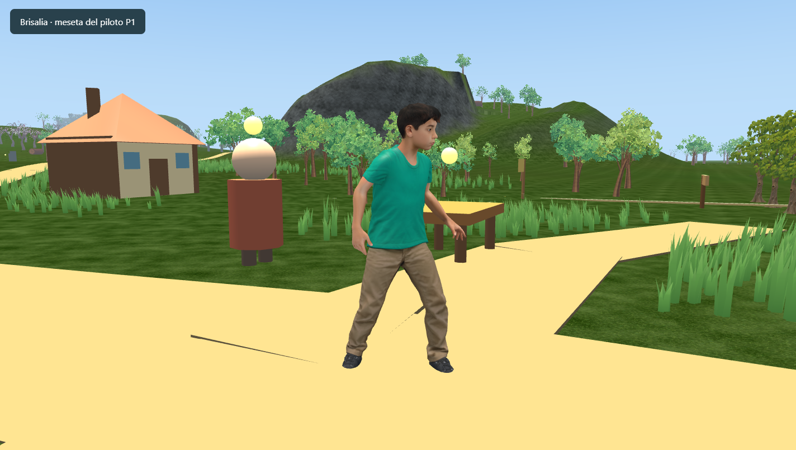

# Relieve piloto del Valle de los Faroles

**08/11/2026 · P0 y P1.** Primera implementación del atlas operativo `AURALIA_ATLAS.md` y su versión Word aportados por el usuario. El terreno ya incorpora una cuenca, lomas, una garganta alrededor del arroyo existente y una meseta con dos accesos. La escala continental sigue abierta hasta completar y medir la región.

La meseta alcanza unos 56 m de altura canónica, aproximadamente 48 m sobre Brisalia. Es un emplazamiento provisional para estudiar el recorrido y las vistas; todavía no contiene la Fortaleza de Valderroca ni añade un lugar persistente al atlas. El resto del continente conserva su relieve.

## Implementación

[`regionalReliefData.ts`](../src/world/regionalReliefData.ts) contiene la versión del piloto, límites, formas, perfiles de acceso y zonas protegidas. [`regionalRelief.ts`](../src/world/regionalRelief.ts) aplica esas formas con transiciones suaves y soporte espacial acotado. [`terrainData.ts`](../src/world/terrainData.ts) integra el resultado en `sampleMainlandHeight`, antes del tratamiento existente de agua/geología y de las ediciones locales.

No se añade una malla visual distinta del suelo físico. Terreno, apoyo, colisiones, vegetación y props reciben la misma altura; el movimiento sigue interpolando los triángulos visibles del LOD cercano. El piloto no depende del World Editor para definir sus formas. Se conserva la aplicación final de las ediciones anteriores por compatibilidad.

La isla mantiene su envolvente actual; near/mid/far siguen en 252/720/1700 m y la malla cercana conserva 12 subdivisiones por sector de 72 m. No se añadieron texturas, materiales de juego ni GLB. La implementación local ya utiliza `TerrainMaterialV2` en `TerrainStream`, a diferencia de la revisión de GitHub citada en el atlas recibido.

## Recorridos de prueba

Las coordenadas siguientes son puntos de prueba de P1, no ubicaciones definitivas de ciudades nuevas. Los puntos de observación están exportados en `FAROLES_REVIEW_POINTS`.

| Lugar | X / Z | Qué revisar |
| --- | --- | --- |
| Brisalia | 1 / 10 | Mirar al oeste/noroeste: la meseta debe sobresalir detrás de la aldea |
| Inicio del ascenso | −142 / −92 | Acceso gradual por la ladera sur |
| Cuenca de cerezos | −20 / −215 | Fondo más bajo, enmarcado por lomas al norte |
| Ribera alta de la garganta | 90 / −260 | Diferencia entre la cresta y el arroyo; observar desde tierra firme |
| Meseta | −270 / −95 | Plataforma, acceso alternativo y vista hacia el núcleo |

El ascenso principal recorre `(-142,-92) → (-185,-60) → (-235,-40) → (-305,-55) → (-325,-110) → (-285,-125) → (-270,-95)`. La alternativa une `(-165,-170) → (-207,-136) → (-245,-128) → (-285,-125)`. Son corredores de relieve; el acabado de caminos corresponde a una etapa posterior.

En Chrome, con Santi, vegetación y colisiones reales, se completaron ambos ascensos sin bloqueo: unos **30 s** por el principal y **12,5 s** por la alternativa. La prueba automatizada del controlador recorre ambos en subida y bajada, caminando y corriendo, y verifica salto/aterrizaje sobre la meseta. Esa prueba aísla el suelo; la comprobación en navegador incluye los objetos de la escena.

## Compatibilidad verificada

La [línea base previa](../tests/fixtures/brisalia-relief-baseline.json) conserva alturas canónicas y alturas interpoladas de apoyo. Las [pruebas del relieve](../tests/regional-relief.test.cjs) comparan el nuevo terreno con esos valores capturados antes de implementarlo.

- Las nueve anclas históricas, 321 muestras de caminos y 525 muestras del núcleo mantienen exactamente su altura y apoyo.
- El Claro del Hogar y su margen de apoyo quedan protegidos, junto con los accesos, puntos de interés, bosque ilustrado, lagos y cascada existentes.
- Se comprueba la carga de una estructura v1 sin ancla ni `baseY`, conservando su ID, posición y suelo de apoyo; las pruebas generales también cubren el guardado moderno.
- Los bordes de la región tienen continuidad de altura y derivada. Ambos accesos quedan por debajo del límite de pendiente de Santi, con margen para la triangulación cercana.
- El cauce existente conserva su fondo y sus niveles; P1 eleva las paredes alrededor. No se cambió el sistema de agua.

El documento local del mundo no tenía ediciones de altura ni assets colocados dentro del área modificada. Las ediciones y assets de la cascada están fuera del piloto y conservan sus coordenadas.

## Capturas y medición

[Antes](evidence/valle-faroles-p1/antes.png) y [después](evidence/valle-faroles-p1/despues.png) muestran Brisalia con el mismo punto de observación. La imagen superior levanta la cámara para ver la silueta completa de la meseta. También se inspeccionó el terreno sin decoración ni texturas durante la prueba.

Muestra indicativa en Chrome/WebGL2, render interno 1424 × 805, mediodía fijo, posición `(-130,-80)`, misma orientación, 300 intervalos de frame con el personaje quieto. La medición final usó un proceso de prueba recién iniciado para excluir la memoria temporal de las recargas de desarrollo.

| Medida | Antes | P1 |
| --- | ---: | ---: |
| Frame mediano | 13,9 ms | 7,0 ms |
| P95 | 27,8 ms | 13,9 ms |
| P99 | 41,6 ms | 14,0 ms |
| Frames mayores de 50 ms | 0 / 300 | 0 / 300 |
| Heap JS al finalizar | 317,7 MiB | 282,3 MiB |
| Materiales cargados | 328 | 328 |
| Texturas cargadas | 193 | 193 |
| Geometría del terreno residente | 3.097.184 bytes | 3.097.184 bytes |

En una muestra adicional de P1 se observaron 322 draw calls, 272 mallas activas y ninguna tarea de terreno pendiente. No se obtuvo una muestra equivalente de draw calls antes del cambio.

Estas capturas cortas no constituyen una prueba de mejora de rendimiento ni de estabilidad prolongada. El heap JS no es la RAM total de Chrome; la carga asíncrona, la recolección de basura y la vegetación visible pueden alterar las mediciones. P5 deberá comparar rutas completas repetidas y memoria del proceso con una carga de contenido representativa.

## Validación y siguientes etapas

Pasaron `npm run check`, `npm test` y `npm run build`, además de las comprobaciones de navegación y capturas en Chrome. El build mantiene el aviso previo por tamaño del bundle principal. Se ejecutó `npm run map:terrain`; el SVG resultante no cambió, porque representa biomas, costa, rutas e hitos, no la elevación detallada del piloto.

Quedan para las siguientes etapas del atlas: cauces y suelos definitivos (P2), distribución ecológica y acabado de caminos (P3), aldea/fortaleza y primera cueva explorable (P4), y validación de la región completa para decidir la escala (P5). La malla actual basta para este relieve amplio; los detalles de gargantas y acantilados exigirán refinamiento local si sus dimensiones superan lo que representa la cuadrícula de 6 m.

En este checkout `terrainData.ts` tiene la marca Git `skip-worktree`. Su integración está aplicada y probada en disco; esa marca hace que el diff ordinario no la muestre. Se conservaron las marcas existentes del índice.
