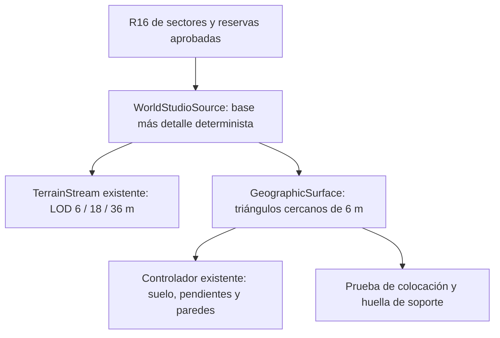

# World Studio como fuente geográfica de Auralia

Primera implementación, 12 de noviembre de 2026, rama `feat/worldstudio-v36-preview`.

El sector de validación utiliza **el `TerrainStream`, el material de terreno y el
`CharacterTraversalController` del juego**. World Studio aporta alturas y reservas
geográficas. El renderizador anterior del preview queda como referencia histórica;
no es la arquitectura del mundo nuevo.

## Probar la integración

Con `npm run dev`:

- `/world-preview.html?source=worldstudio-hybrid`: sector nuevo, fuente híbrida.
- `/world-preview.html?source=legacy`: mismo banco de pruebas con geografía actual.
- `/world-preview.html?source=import-reference`: importación anterior completa.
- `/`: juego actual, que sigue utilizando su geografía y sus guardados habituales.

El selector está en la herramienta de validación. Todavía no cambia la fuente de
`WorldView`. Esta herramienta no instancia `GameStore` ni `SaveRepository`.
Se camina con WASD, se mira arrastrando el mouse, Espacio salta y Shift corre.
Hay tres posiciones reproducibles y exportación de las mediciones a JSON.

## Una sola superficie

`GeographicSource` entrega alturas de vértice; `GeographicSurface` resuelve la altura
y la pendiente del **triángulo cercano real**, mediante `nearTerrainSurfaceAt`.
No utiliza una interpolación suave distinta para la colisión. Su `footprintAt`
ofrece el mismo soporte a la colocación de objetos y a la futura construcción.



Sólo hay un conjunto de mallas de terreno. El adaptador de colisión consulta
alturas y normales, sin crear otro terreno invisible o superpuesto. La colocación
se demuestra con un bloque de prueba; la construcción jugable aún no está migrada.
Tampoco se activan colisiones de objetos o agua en esta escena inicial.

### Fuente híbrida y protección geográfica

- Los 25 R16 permanecen intactos: 640 × 640 muestras uint16 LE por sector de
  2.800 m, 819.200 bytes, separación de datos **4,3818466 m**. Se decodifican con el
  rango original y se interpolan bilinealmente para consultar posiciones.
- La malla cercana conserva los **6 m del motor actual**. Resolución de datos y
  resolución renderizada son distintas. No se subdivide artificialmente el R16.
- La auditoría anterior encontró un sculpt global de 640 × 640 sobre 14 km,
  equivalente a 21,909 m. Por tanto, el R16 exportado no demuestra por sí solo
  detalle independiente cada 4,38 m; no se presenta como fotogrametría recuperada.
- Se añade relieve determinista con semilla 271828, escalas 48 y 18 m y amplitud
  total acotada a ±1,25 m. Usa coordenadas mundiales, sin aleatoriedad por chunk.
- El detalle se anula en los polígonos de lagos, reservas de asentamientos,
  corredores de splines y banda costera. Hay márgenes y desvanecimiento gradual.
  Los marcadores de Brisalia/Ferragrís añaden una protección conservadora.
- Las pendientes abruptas atenúan el detalle hasta anularlo; no se suavizan los
  acantilados de la fuente. No se aplican los cauces tallados ni los 152 trazos de
  altura de la geografía antigua a las coordenadas nuevas.

Las máscaras preservan las alturas fuente en esas zonas; no corrigen errores
geográficos o hidráulicos del archivo de autoría. La aproximación de malla de
6 m sigue siendo una aproximación: la fidelidad final de cada orilla requiere
validación cuando se incorpore el agua.

### Streaming y materiales existentes

El constructor de `TerrainStream` acepta una fuente opcional; su valor predeterminado
es exactamente el sampler actual. En la fuente híbrida también se descarga el LOD
lejano, en una ventana local de radio 1.700 m. Se conservan tamaños de chunk
72/144/288 m, topologías, perímetros compatibles y sustitución de padres por grupos
completos de hijos del sistema existente.

La fuente carga únicamente los R16 que intersectan la ventana con su margen de
muestreo: **máximo 9 sectores residentes**, 7,03125 MiB de alturas decodificadas.
En el sector inicial son 4; en el cruce probado, 6. No se conserva una copia CPU
completa del continente ni sus 25 mallas de máxima resolución. Puede haber buffers
transitorios de las dos lecturas simultáneas y caché del navegador; el límite de
alturas no pretende representar toda la memoria del proceso.

Si faltan datos, se detiene el avance y se cargan antes de generar terreno. Un fallo
se muestra explícitamente: no se sustituye por altura cero ni por terreno antiguo.
El movimiento exige cobertura cercana. Los chunks que exceden el borde exterior
del scaffold se descartan; queda pendiente cerrar y validar ese límite exterior
(hasta un chunk lejano de margen), fuera del sector inicial de esta entrega.

Se reutilizan el catálogo PBR, arrays de texturas, normales, mezcla por pendiente
y proyección triplanar del juego. Sus fuentes son 1K y sus arrays actuales de GPU
son 512, como en el juego. Para la fuente híbrida se desactivan las máscaras de
biomas y las cáusticas de laguna ancladas a coordenadas antiguas. La distribución
completa de biomas nuevos sigue pendiente; este sector mezcla hierba, tierra,
roca y arena según pendiente y altura.

## Mediciones reproducibles

Chrome headless con perfil nuevo, GPU real **RTX 3090 / ANGLE D3D11**, ventana
1600 × 900 y render interno 1200 × 675. Cámara a 1,75 m del suelo, límite de 30 FPS,
18 s de estabilización y ventana de 300 frames. No hubo excepciones de ejecución;
la referencia del juego completo registró un 404 de `favicon.ico`. Los JSON y PNG están en
[`artifacts/geographic-source/browser`](../artifacts/geographic-source/browser/).

La comparación controlada usa el mismo banco de pruebas, iluminación y material:
terreno actual con su documento de autoría frente al sector híbrido. Las posiciones
son `(0,10)` y `(-1100,1900)`, respectivamente; el relieve es distinto. La referencia
del juego completo usa `WorldView`, una partida de prueba en memoria y la cámara
de Brisalia `(0,10)`. Incluye vegetación, edificios, agua y otros sistemas: su costo
no es directamente comparable con dos escenas que contienen sólo terreno.

| Métrica, vista inicial | Terreno actual | Sector híbrido | Juego actual completo, Brisalia |
|---|---:|---:|---:|
| Separación cercano / medio / lejano | 6 / 18 / 36 m | 6 / 18 / 36 m | 6 / 18 / 36 m |
| Triángulos de terreno residentes | 107.520 | 81.792 | 107.520 |
| Triángulos de terreno visibles | 19.584 | 18.720 | 19.584 |
| Triángulos de toda la escena visibles | 19.584 | 18.720 | 911.001 |
| Buffers de terreno estimados, MiB | 4,41 | 3,29 | 4,41 (misma topología) |
| Datos R16 residentes, MiB | — | 3,125 (4 sectores) | — |
| Heap JS medido, MiB | 121,30 | 93,51 | 376,64 |
| Memoria privada de Chrome completo, MiB | 735,21 | 710,45 | 1.351,43 |
| Working set de Chrome completo, MiB | 1.013,32 | 984,48 | 1.307,81 |
| FPS efectivo, 1000 / mediana del frame | 28,82 | 28,82 | 29,07 |
| Frame mediana / p95, ms | 34,70 / 35,00 | 34,70 / 35,20 | 34,40 / 40,20 |
| GPU mediana / p95, ms | 1,94 / 6,32 | 0,92 / 4,18 | 5,78 / 11,37 |
| CPU render mediana / p95, ms | 0,80 / 1,50 | 0,80 / 1,70 | 6,70 / 13,50 |
| Generación por actualización con trabajo, mediana / p95 / máximo, ms | 7,60 / 14,50 / 45,50 | 6,80 / 12,30 / 26,70 | No instrumentada |
| Arranque hasta escena lista, ms | 8.728 | 9.654 | No instrumentado |

Los buffers son la estimación existente de `TerrainStream`, no una medición de
VRAM. Heap, memoria privada y working set son métricas distintas y no se suman.
Las dos últimas incluyen todos los procesos de **una instancia aislada de Chrome**,
no sólo la pestaña. Los valores históricos de 500 MB/1,1 GB no tienen esa misma
definición y no permiten calcular una reducción porcentual válida. El contador
interno del motor informa aproximadamente 30 FPS; se muestra también la cadencia
efectiva medida. El límite impide inferir FPS máximos sin limitación.

### Densidad por LOD, vista inicial

| Fuente / LOD | Chunks residentes / habilitados | Vértices residentes | Triángulos residentes | Triángulos en frustum |
|---|---:|---:|---:|---:|
| Actual / cercano | 64 / 64 | 10.816 | 18.432 | 6.336 |
| Actual / medio | 128 / 112 | 18.560 | 24.576 | 5.760 |
| Actual / lejano | 224 / 70 | 53.984 | 64.512 | 7.488 |
| Híbrido / cercano | 68 / 68 | 11.492 | 19.584 | 6.336 |
| Híbrido / medio | 120 / 103 | 17.400 | 23.040 | 4.608 |
| Híbrido / lejano | 136 / 106 | 32.776 | 39.168 | 7.776 |

Hay padres residentes deshabilitados durante el refinamiento; residente no significa
dibujado. Los perímetros compatibles incluyen más vértices que una cuadrícula
interior uniforme de 18 o 36 m.

Capturas para inspección: [actual](../artifacts/geographic-source/browser/legacy-terrain-sector.png),
[híbrido](../artifacts/geographic-source/browser/hybrid-sector.png),
[relieve híbrido](../artifacts/geographic-source/browser/hybrid-detalle.png),
[borde entre sectores](../artifacts/geographic-source/browser/hybrid-borde.png) y
[juego completo](../artifacts/geographic-source/browser/main-vegetacion.png).
En estas vistas se observa el terreno con el material del juego y continuidad de
suelo. No se presenta esta entrega como validación de costas, agua o vegetación nuevas.

La generación conserva un presupuesto objetivo de 4 ms, pero cada chunk es una
operación indivisible. **No cumple un máximo estricto de 4 ms**: la vista de borde
registró un pico de 59,9 ms al generar, con p95 13,6 ms. Separar generación de
buffers en trabajo incremental o worker es un siguiente paso antes de ampliar el
recorrido jugable. Los frames estabilizados no describen esos tirones de carga.

## Pruebas

- `npm run check`: correcto.
- Build de producción: TypeScript y `vite build`, correctos. Se corrigió el
  arranque asíncrono para conservar el target ES2020. Vite sigue avisando del tamaño
  del bundle compartido de Babylon/materiales; no se ocultó ese aviso.
- `npm run test:geographic-source`: 851 muestras deterministas, 443 con detalle
  efectivo, amplitud acotada, zonas protegidas, ausencia de datos, fallo de carga,
  presupuesto, expulsión y recarga. Incluye 64 raycasts sobre las mallas reales
  frente al sampler de colisión (error < 1 mm), controlador real y huella de soporte.
- `npm run test:stream`: cobertura, prioridades, transiciones, teleport y superficie
  canónica del sistema existente, correcto.
- `npm run test:traversal`: salto, aterrizaje, pendientes, paredes y escalada, correcto.
- `npm run test:building`: soporte, colisiones y guardados legacy, correcto.
- `node tests/validar_assets.mjs`: 25 R16, 40 uniones y 2 GLB originales, correcto.
- Prueba de navegador: 110,00 m caminados desde `(-1390,2070)` hasta
  `(-1500,2070)`, cruzando X=-1400. En 330 frames: error de apoyo 0, ninguna pérdida
  de LOD cercano y máximo 6 R16 residentes. Resultado en `hybrid-walk.json`.
  Una tentativa previa por una pendiente abrupta quedó detenida correctamente;
  el cruce final utiliza un tramo transitable, sin desactivar la física.

Reproducir la comparación en un Chrome de prueba aislado:

```powershell
node scripts/benchmark-world-preview-browser.mjs --run --geographic --modes=legacy-terrain,hybrid --views=sector,detalle,borde
node scripts/benchmark-world-preview-browser.mjs --run --geographic --modes=hybrid --views=borde --walk
node scripts/benchmark-world-preview-browser.mjs --run --geographic --modes=main --views=vegetacion
```

## Migración progresiva y coordenadas pendientes

La siguiente integración debe inyectar **la misma instancia de `GeographicSurface`**
en los consumidores de `WorldView`. No basta con sustituir su sampler de render.
Las posiciones de contenido deben convertirse mediante marcos regionales explícitos
y anclas con identificador; no mediante una escala o traslación global del mundo.

| Sistema | Dependencia actual que falta adaptar |
|---|---|
| `WorldView` | Altura al caminar, callbacks de construcción, spawn, zonas y colocación con coordenadas legacy |
| `terrainData`, `WorldEditState` | Relieve, rutas, landmarks y 152 trazos de altura del documento actual; sólo se cargan en la fuente legacy |
| `GeographyStream`, `geographicFeatures` | Elementos geográficos y niveles de agua vinculados a posiciones antiguas |
| `LagoonSystem`, `lagoonData`, `WatershedHydrology`, `MountainPassSystem` | Laguna, cauces, cascadas, puentes, accesos y conexiones de cuevas |
| `VegetationSystem`, `GrassSectorSystem`, `GrassSectorBake`, `vegetationData` | Muestreo de altura, distribución y biomas antiguos |
| `WorldPropSystem`, `worldPropsData`, `expansionBiomeData`, `AuthoredAssets` | Objetos, reservas, recursos y anclas de contenido |
| `BuildVisuals` y construcción en `WorldView` | Origen de la cuadrícula de Brisalia y soporte del terreno; conservar IDs y reglas de construcción |
| `RegionCatalog`, `regions`, `mapProjection` y minimapa | Límites regionales, marcadores, rutas y proyección de la geografía anterior |

1. **Brisalia.** Su landmark legacy es `(0,-23)` y el ancla aprobada nueva es
   `(-1250,1920)`. Mantener distancias locales en metros, IDs, cuadrícula, relaciones
   entre edificios/NPC/recursos y sistemas de progreso. Trasladar el marco regional
   y resolver apoyo mediante `footprintAt`, manteniendo la plataforma reservada.
   Revisar caminos y entradas como conexiones entre anclas. Nada de esto modifica
   todavía una partida existente.
2. **Laguna de las Tres Vertientes.** La actual tiene centro `(-160,-810)`, extensión
   340 × 270 m y profundidad de diseño 18 m; entrada sur `(-160,-650)`, acceso de
   cueva `(-6,-858)` y salidas `(50,-1060)` / `(160,-720)`. El polígono maestro nuevo
   `tres-vertientes` ocupa X entre -3050,27 y -2290,18 m, Z entre -1350,58 y -742,68 m.
   El bookmark que todavía indica `(-160,-810)` es legacy: **no debe usarse para
   colocar la laguna nueva**. Migrar el conjunto jugable como región con puertos
   de entrada/salida, preservando orientación hidráulica y conexiones. Los
   interiores de cuevas conservan sus coordenadas locales; se adaptan sus accesos.
3. **Agua.** Reutilizar `LagoonSystem`, la hidrología y los materiales acuáticos
   existentes. El documento maestro aún tiene `waterlineY_m: null`; hace falta
   definir cotas de agua y resolver discontinuidades de perfiles antes de colocar
   superficies jugables. La auditoría previa detectó 765/4.547 muestras de cauce
   inconsistentes y un enlace Prado–Vertientes con una separación de unos 255 m.
   El proveedor no oculta esos problemas tallando un segundo terreno.
4. **Otros reinos.** Incorporar regiones una a una, con anclas, rutas y pruebas de
   soporte. Albor conserva su ubicación al oeste `[-4750,1350,-3500]` y Umbrael al
   este `[5200,1200,-3700]` (XYZ del manifiesto). Son regiones flotantes: mantener
   modelos originales, transformación de ejes y colisionadores propios; no
   proyectarlas sobre el heightmap continental.
5. **Persistencia.** Antes de llevar el selector al juego, identificar cada mundo
   por fuente y versión y usar slots separados. La geografía actual sigue siendo
   predeterminada para partidas actuales. Una conversión de guardados requerirá
   una operación explícita futura; no se implementó ninguna migración automática.

Esta entrega valida el proveedor y su integración inicial con terreno, materiales,
colisión del personaje y LOD reales. El traslado de sistemas jugables, agua,
vegetación, biomas completos y el cierre del límite continental sigue pendiente.
